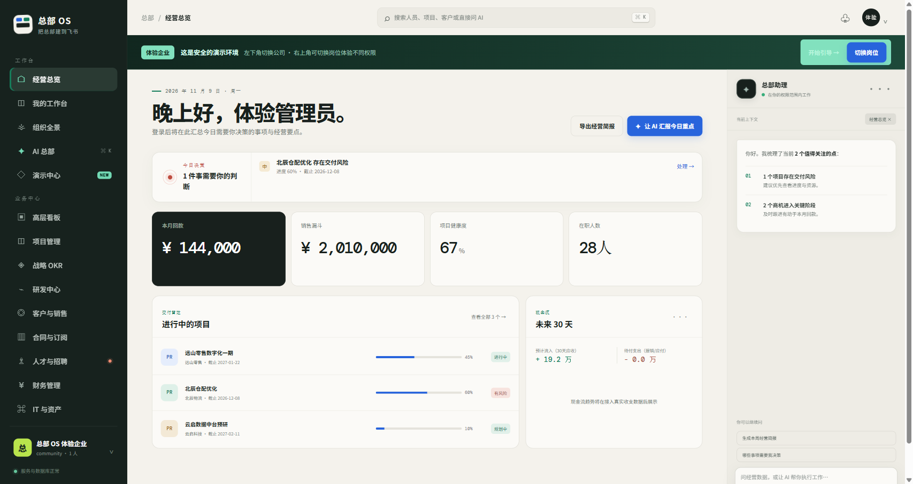
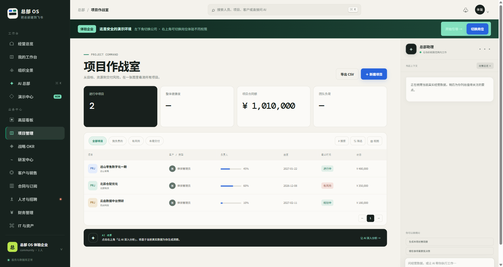

# Headquarters OS · a full-stack Lark starter

**Start with the Lark plumbing in place.** Headquarters OS brings SSO, organization sync, sessions, tenant isolation, authorization, audit trails, and working business examples into one open-source codebase. It reduces repetitive setup before you build your own workflows.

[简体中文](./README.md) · [日本語](./README.ja.md) · [Overview](https://feishubanlv.com/feishu-hq) · [Live demo](https://feishubanlv.com/feishu-hq/demo/)

In China, Lark is known as **Feishu (飞书)**. The interface and primary documentation are in Chinese. The demo uses sample companies and roles; do not enter real customer data.

> **Enterprise AI consulting & development** (Feishu/Lark integration, private deployment, custom builds) → [buildwithneo.cn](https://buildwithneo.cn/)



## Included today

- Lark/Feishu OAuth SSO, sessions, and organization synchronization.
- PostgreSQL tenant isolation, role and attribute based access control, and audit events.
- Example modules for projects, CRM, contracts, finance, HR, and more.
- API, worker, ordered database migrations, Docker Compose, and a native JavaScript frontend.
- Permission-aware AI tools and demo organizations.



Robot messaging and some interactive-card code already exist. Future releases will deepen support for **Lark cards, Base/Bitable**, and other Lark surfaces. This roadmap is an intention, not a claim that every surface is ready today. We plan to keep publishing versions and migration notes.

## Try it or run locally

Start with the [overview page](https://feishubanlv.com/feishu-hq), then open the [live demo](https://feishubanlv.com/feishu-hq/demo/), choose the demo organization, and switch roles to explore the workbench, projects, customers, and finance. Initial loading depends on the server network; previously loaded views use a local cache.

Requirements: Node.js 22+, PostgreSQL 16 or Docker Desktop.

```bash
git clone https://github.com/wechat-numbshark/feishu-hq.git
cd feishu-hq
npm ci
cp deploy/compose/.env.example deploy/compose/.env
# Set random passwords and SESSION_SECRET; for local demo use DEMO_MODE=true, TRUST_PROXY=false, COOKIE_SECURE=false
docker compose --env-file deploy/compose/.env -f deploy/compose/docker-compose.yml up -d
```

See the [development guide](./docs/DEVELOPMENT.md). Demo mode is useful locally; disable it and use HTTPS and unique secrets in production. Released under [AGPL-3.0](./LICENSE). This community project is not affiliated with Lark or Feishu.
