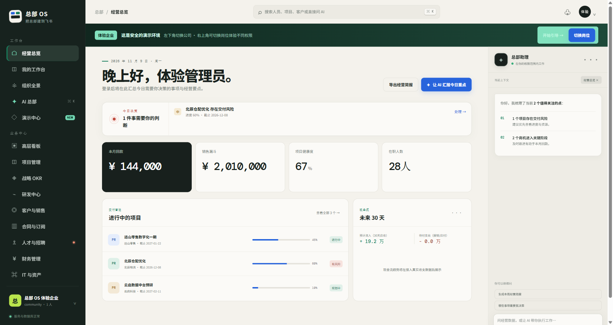
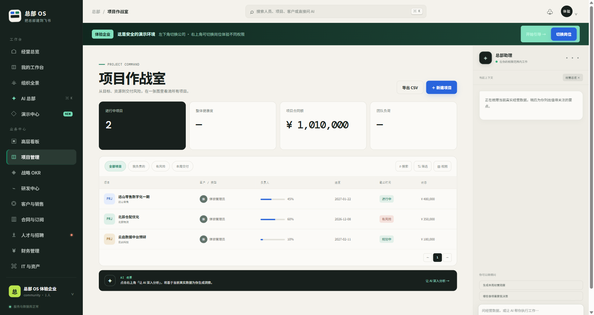

# Headquarters OS · Lark フルスタック開発の土台

**Lark 連携の準備を繰り返さず、業務機能の開発を始められます。** Headquarters OS は SSO、組織同期、セッション、テナント分離、権限管理、監査と業務サンプルを一つのオープンソースプロジェクトにまとめています。

[简体中文](./README.md) · [English](./README.en.md) · [紹介ページ](https://feishubanlv.com/feishu-hq) · [デモを試す](https://feishubanlv.com/feishu-hq/demo/)

中国では Lark は **飛書（Feishu）** の名称で提供されています。現在の画面と主な文書は中国語です。デモには架空の企業・役職データを使用しています。実際の顧客情報は入力しないでください。

> **企業向け AI 化のコンサルティングと開発**（Feishu/Lark 連携、プライベート導入、カスタム開発）→ [buildwithneo.cn](https://buildwithneo.cn/)



## 現在含まれるもの

- Lark/Feishu OAuth SSO、セッション、組織情報の同期。
- PostgreSQL によるテナント分離、役割・属性ベースの権限管理、監査記録。
- プロジェクト、顧客管理、契約、財務、人事などの業務サンプル。
- API、Worker、DB マイグレーション、Docker Compose、標準 JavaScript の画面。
- 権限の範囲で動く AI ツールと、操作を試せるデモ企業。



ボットメッセージと一部のインタラクティブカードのコードはすでにあります。今後は **Lark カード、Base/Bitable（多次元テーブル）** などへの対応を広げ、継続的にバージョンを公開する予定です。これはロードマップであり、全機能が実装済みという意味ではありません。

## 試す・動かす

[紹介ページ](https://feishubanlv.com/feishu-hq) から [公開デモ](https://feishubanlv.com/feishu-hq/demo/) に入り、体験企業を選んで役職を切り替え、ダッシュボード、プロジェクト、顧客、財務を確認できます。

Node.js 22 以上、PostgreSQL 16 または Docker Desktop が必要です。

```bash
git clone https://github.com/wechat-numbshark/feishu-hq.git
cd feishu-hq
npm ci
cp deploy/compose/.env.example deploy/compose/.env
# ランダムなパスワードと SESSION_SECRET を設定。ローカルデモでは DEMO_MODE=true、TRUST_PROXY=false、COOKIE_SECURE=false
docker compose --env-file deploy/compose/.env -f deploy/compose/docker-compose.yml up -d
```

設定は[開発ガイド](./docs/DEVELOPMENT.md)をご覧ください。コードは [AGPL-3.0](./LICENSE) で公開します。このコミュニティプロジェクトは Lark/Feishu 公式とは関係ありません。
