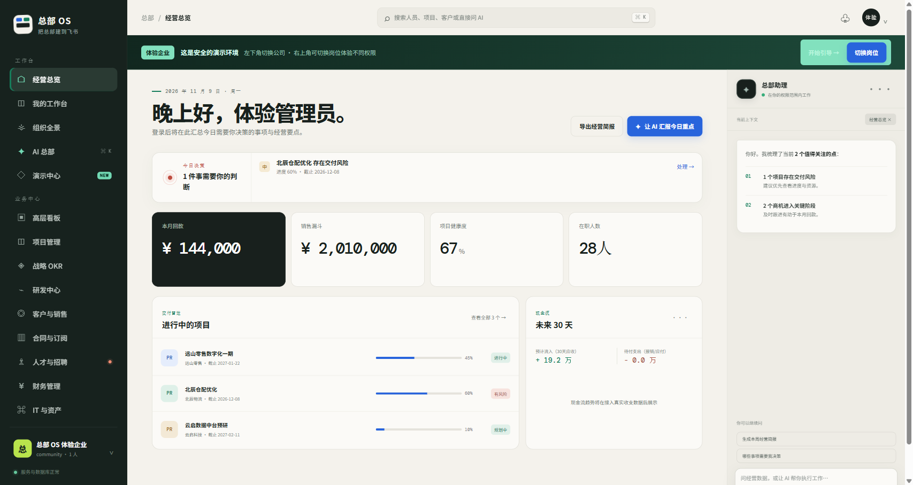
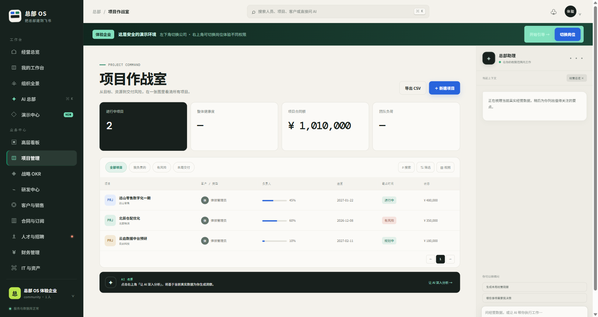

# 总部 OS · 飞书全栈开发脚手架

**把飞书接入、身份、组织、权限和业务示例放进一个可运行的起点。** 总部 OS 整合 SSO、组织同步、会话、多租户隔离、审批和管理界面，减少飞书项目反复搭建基础功能的工作量，让团队更快进入自己的业务开发。

[English](./README.en.md) · [日本語](./README.ja.md) · [介绍页](https://feishubanlv.com/feishu-hq) · [在线演示](https://feishubanlv.com/feishu-hq/demo/) · [飞书伴侣](https://feishubanlv.com)

> 项目以中文为主。海外开发者可将飞书理解为 Lark。在线体验使用演示数据，请勿输入真实客户信息。

> **接企业 AI 化咨询与开发**（飞书/Lark 集成、私有化部署、定制开发）→ [buildwithneo.cn](https://buildwithneo.cn/)



## 已有基础

| 能力 | 用途 |
| --- | --- |
| 飞书 OAuth SSO、会话与组织同步 | 接入自己的企业身份 |
| 多租户隔离、RBAC/ABAC 权限、审计 | 按公司和岗位划定数据边界 |
| 项目、客户、合同、财务、人事等业务示例 | 挑选并改造自己的流程 |
| API、Worker、PostgreSQL 迁移、Docker Compose | 本地开发与重复部署 |
| 受权限约束的 AI 工具与演示企业 | 体验跨模块工作流 |



当前已有机器人消息和部分互动卡片代码。后续版本会继续完善**飞书卡片、多维表格（Base/Bitable）**等形态，并逐步覆盖更多飞书能力。这是开发方向，不表示所有形态已经交付。项目将持续发布版本与迁移说明。

## 在线体验

可先打开[介绍页](https://feishubanlv.com/feishu-hq)，再进入[在线演示](https://feishubanlv.com/feishu-hq/demo/)，选择「进入体验企业」，切换公司和岗位，查看工作台、项目、客户与财务等页面。首次加载受演示服务器网络影响；已加载页面支持本地缓存。

## 本地运行

需要 Node.js 22+、PostgreSQL 16 或 Docker Desktop。

```bash
git clone https://github.com/wechat-numbshark/feishu-hq.git
cd feishu-hq
npm ci
cp deploy/compose/.env.example deploy/compose/.env
# 设置随机密码和 SESSION_SECRET；本地体验另设 DEMO_MODE=true、TRUST_PROXY=false、COOKIE_SECURE=false
docker compose --env-file deploy/compose/.env -f deploy/compose/docker-compose.yml up -d
```

配置与迁移详情见[开发指南](./docs/DEVELOPMENT.md)。未配置飞书应用时可先使用演示模式；生产环境应关闭演示模式、配置 HTTPS 与独立密钥。

## 架构与许可

Node.js 22 + TypeScript；原生 Web 前端；PostgreSQL 16；API 与 Worker 分工。核心代码在 `apps/`、`packages/` 和 `modules/`；迁移在 `database/migrations/`。敏感操作在服务端检查权限并记录审计事件。

代码按 [AGPL-3.0](./LICENSE) 发布。参与前请阅读[贡献指南](./CONTRIBUTING.md)与[安全策略](./SECURITY.md)。本项目与飞书/Lark 官方无隶属关系。
